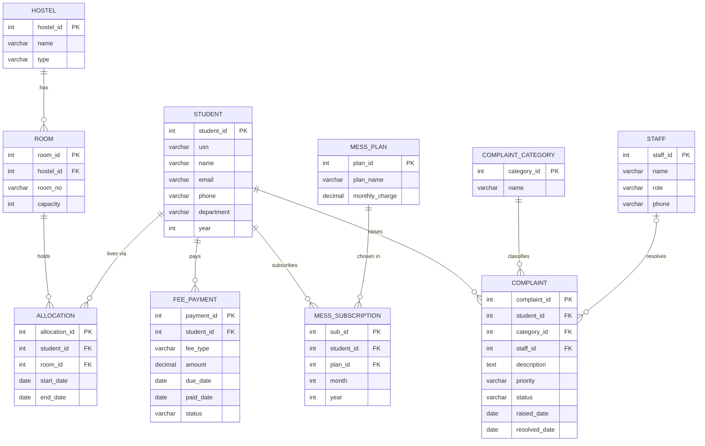

# Hostel Mess & Complaint Tracker
DBMS Mini Project (BTCS531) | Flask + MySQL

**Problem:** Hostel complaints get lost, fees are tracked in registers, and rooms get over-allocated.
**Solution:** One database that enforces the rules itself (triggers, constraints) and shows what needs attention (views, reports).

## Run it
1. Install MySQL 8 (or MariaDB 10.5+) and Python 3.10+.
2. Load the database, in order:
   ```
   mysql -u root -p < sql/01_schema.sql
   mysql -u root -p < sql/02_sample_data.sql
   ```
   (`sql/03_queries.sql` holds every demo query. Run it in MySQL Workbench, one block at a time.)
3. Start the app:
   ```
   pip install -r requirements.txt
   set DB_PASSWORD=your_mysql_password      (Windows)   |   export DB_PASSWORD=your_mysql_password   (Mac/Linux)
   python app.py
   ```
4. Open http://127.0.0.1:5000

Optional environment variables: `DB_HOST`, `DB_USER` (default `root`), `DB_NAME` (default `hostel_db`).

## ER diagram
Paste into https://mermaid.live to export an image for the report.


## Normalization (use this in the report)
**Unnormalized (one big sheet):** `usn, student_name, email, hostel_name, room_no, room_capacity, fee_type, fee_amount, complaint_text, category, staff_name, staff_phone`
- **1NF:** every cell holds one value, so repeated fees and complaints become separate rows, not comma lists.
- **2NF:** attributes that depend on only part of a key move out. `room_capacity` depends on the room, not the student, so it goes to `Room`. `monthly_charge` depends on the plan, so it goes to `Mess_Plan`.
- **3NF:** no non-key attribute depends on another non-key attribute. `staff_phone` depends on the staff member, not the complaint, so it goes to `Staff`. The category name moves to `Complaint_Category`. Hostel name and type move to `Hostel`.
- Every table above is in **3NF**, and also **BCNF**, since every determinant is a candidate key.

## Requirement checklist
| Requirement | Where |
|---|---|
| 5+ entities | 10 tables, `01_schema.sql` |
| 4+ relationships | 9 foreign keys (diagram above) |
| PK / FK | Every table; FKs use `ON DELETE CASCADE` or `SET NULL` |
| NOT NULL, UNIQUE, CHECK, DEFAULT | Throughout the schema (e.g. `capacity BETWEEN 1 AND 4`, `status DEFAULT 'Pending'`) |
| INSERT / UPDATE / DELETE / SELECT | CRUD block in `03_queries.sql`, and the Students page |
| 3+ joins | J1 to J4 (inner, left, multi-table, self-style) |
| COUNT, SUM, AVG, MIN, MAX | Aggregates block, `03_queries.sql` |
| 2+ nested queries | N1 to N4 (including a correlated one) |
| 2+ views | `v_pending_complaints`, `v_fee_defaulters`, `v_room_occupancy` |
| 3+ reports | Reports page and R1 to R4 |
| Stored procedure and view (bonus) | `escalate_overdue_complaints()` and `v_escalated_complaints`; "Escalate overdue complaints" button |
| Triggers (bonus) | Room capacity guard, auto resolved date, auto paid date |
| Transaction (bonus) | `START TRANSACTION ... COMMIT` room-move demo |
| Simple UI | Flask pages: Dashboard, Students, Rooms, Complaints, Fees, Mess, Reports |

## Live demo script (5 minutes)
1. **Dashboard:** open complaints, free beds, overdue fees, all from views.
2. **Rooms:** allocate student *Tarun V* to room **G104** (full). The trigger blocks it with an error.
3. **Rooms:** allocate *Rahul Sharma* again. Blocked: "already has an active room".
4. **Complaints:** click **Escalate overdue complaints**. The stored procedure raises every complaint older than 3 days to High, and the dashboard counter "Need warden action" goes up. Then mark one Resolved; the database stamps the resolved date itself.
5. **Fees:** mark a pending fee Paid. The paid date is stamped by a trigger.
6. **Reports:** show resolution time by category and the nested-query reports.
7. In Workbench, run the transaction demo, then repeat it with `ROLLBACK` to show atomicity.

## Folder layout
```
app.py            Flask routes
templates/        HTML pages
static/style.css  styling
sql/              schema, sample data, queries
```
